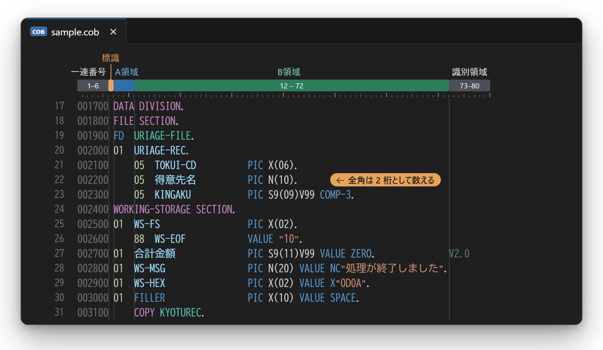
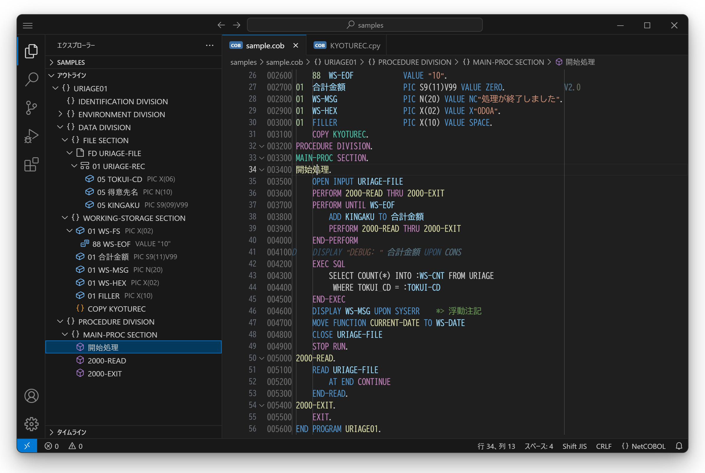
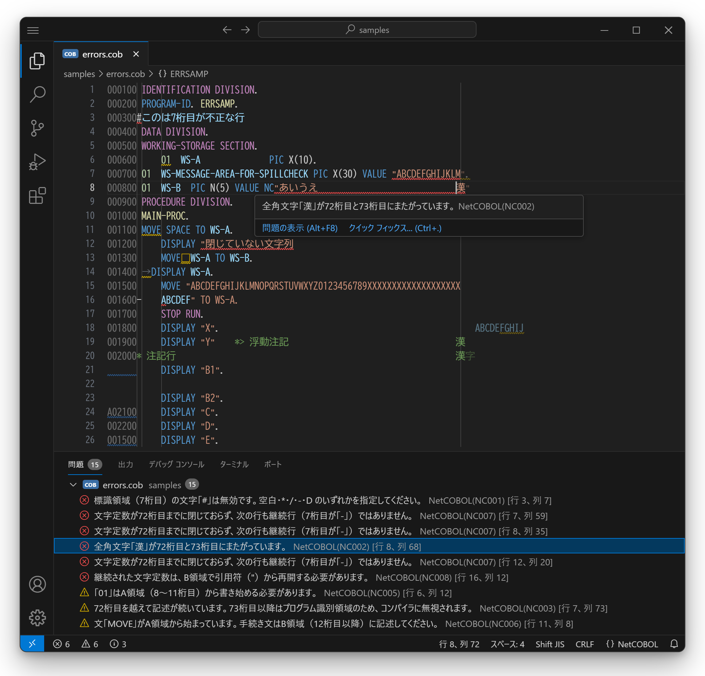
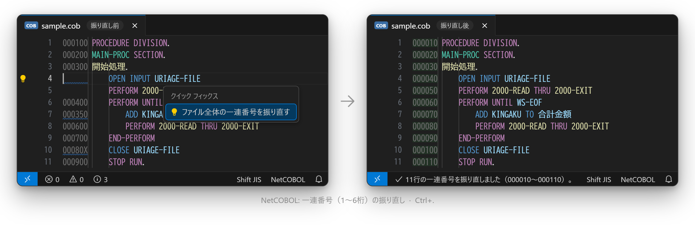
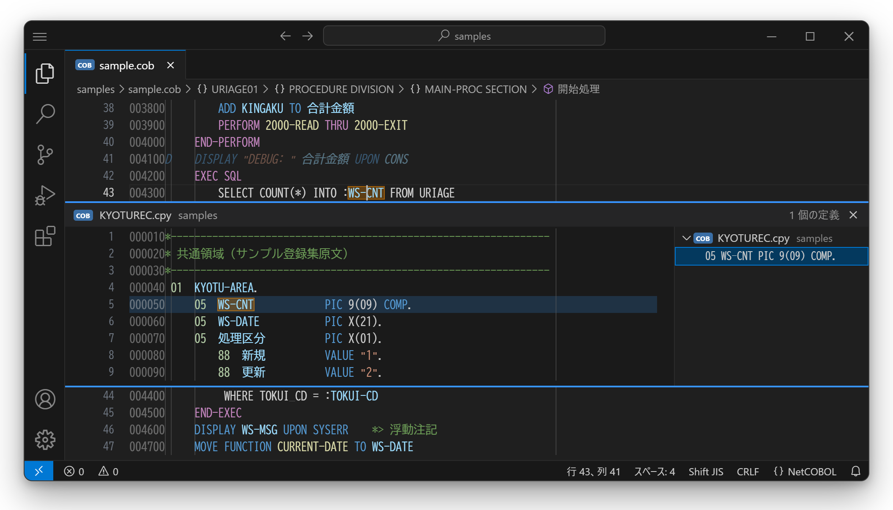

# COBOL Tools for NetCOBOL

[](https://marketplace.visualstudio.com/items?itemName=zhuuchaofan.cobol-tools-for-netcobol)
[](https://github.com/zhuuchaofan/cobol-tools-for-netcobol/actions/workflows/ci.yml)

日本語 | [English](docs/README.en.md) | [简体中文](docs/README.zh-CN.md)

**NetCOBOL の固定形式ソース**を VS Code で快適に読み書きするための拡張機能です。



- **桁がずれない** — 桁位置を **Shift_JIS のバイト数（全角＝2桁）** で数えるので、日本語を含む行でも 72 桁目や A領域の判定がコンパイラと一致します
- **20 種類の書式チェック** — 標識領域・A/B 領域・72 桁越え・閉じていない文字定数・予約語の誤用などを、コンパイル前に問題パネルへ表示
- **一連番号をまとめて振り直し** — 空白・重複・逆順の番号を `Ctrl+.` 一発で `000010, 000020, …` に
- **アウトラインと定義へ移動** — 部・節・段落・データ項目の階層表示、`COPY` した登録集原文の中まで `F12` で追跡
- **日本語・English・简体中文** — メッセージは VS Code の表示言語に合わせて表示

> 本拡張機能は**非公式**です。富士通株式会社とは関係ありません。NetCOBOL は富士通株式会社の登録商標です。

## 主な機能

### 構文ハイライト



- 一連番号領域（1〜6桁）・プログラム識別領域（73〜80桁）を薄く表示（バイト基準なので全角があってもずれない）
- 標識領域（7桁目）：`*` `/` 注記行、`D` デバッグ行、`-` 継続行
- 部・節・段落（日本語の段落名も可）、`PERFORM` / `GO TO` の飛び先
- レベル番号・データ名（日本語可）・`PIC` 文字列・`COMP-3` などの用途
- NetCOBOL の定数：`NC"…"` `N"…"` `NX"…"` `X"…"` `B"…"`
- `@OPTIONS`、`*>` 浮動注記、`EXEC SQL … END-EXEC`（ホスト変数 `:WS-X`）
- `SYSERR` / `CONSOLE` / `ARGUMENT-VALUE` / `ENVIRONMENT-VALUE` などの機能名、特殊レジスタ、`FUNCTION xxx`

### 書式チェック（問題パネル）



<details>
<summary><b>チェック項目の一覧（NC001〜NC020）</b></summary>

| コード | 重大度 | 内容 |
|---|---|---|
| NC001 | エラー | 標識領域（7桁目）の文字が無効（空白 `*` `/` `-` `D` のみ可） |
| NC002 | エラー | 全角文字が 6/7・7/8・72/73 桁の境界にまたがっている（72/73 は注記の中では対象外） |
| NC003 | 警告 | 72桁目を越えて記述が続いている（注記の中では対象外） |
| NC004 | 警告 | 1行が80桁を超えている（上限は設定可） |
| NC005 | 警告 | 部・節・段落の見出し、FD、01/77 が A領域（8〜11桁）から始まっていない |
| NC006 | 警告 | 手続き部の文（MOVE、IF など）が A領域から始まっている |
| NC007 | エラー | 文字定数が72桁目までに閉じておらず、次の行も継続行ではない |
| NC008 | エラー | 継続行が引用符で文字定数を再開していない |
| NC009 | 警告 | 定数・注記以外の全角スペース |
| NC010 | 警告 | タブ文字（桁位置がずれる可能性） |
| NC011 | 警告 | 継続行の A領域が空白でない |
| NC012 | 情報 | 一連番号が空白（連続する行はまとめて1件） |
| NC013 | 情報 | 一連番号が6桁の数字でない |
| NC014 | 情報 | 一連番号が前の行より大きくない |
| NC015 | エラー | 定数の中身が不正（`X"…"` は16進2桁ずつ、`NX"…"` は4桁ずつ、`B"…"` は 0/1、`N"…"`/`NC"…"` は全角のみ） |
| NC016 | 警告 | 部・節の見出しの後に終止符がない |
| NC017 | 警告 | 使えないレベル番号（01〜49、66、77、88 以外） |
| NC018 | エラー | 予約語（付録A）をデータ名・段落名・節名・ファイル名に使っている |
| NC019 | 警告 | 定数の長さが範囲外（文字定数 1〜160 バイト、`X` 2〜320 桁、`NX` 4〜320 桁、`N`/`NC` 1〜80 文字、`B` 1〜160 桁） |
| NC020 | 警告 | 利用者語の形が不正（30 文字超、先頭・末尾が `-` `_`、`__`、英字を含まない、日本語利用者語に漢字・かなを含まない）。日本語と半角英数の混在は情報 |

</details>

メッセージは VS Code の表示言語（日本語／English／简体中文）に合わせて表示されます。

- 7桁目が `D` のデバッグ行は、`SOURCE-COMPUTER` に `WITH DEBUGGING MODE` がなければ注記行として扱い、斜体・薄色で表示します
- `@OPTIONS SRF(VAR)` があれば可変形式（72桁の右端制限なし）、`SRF(FREE)` なら自由形式として桁チェックを止めます（設定 `netcobol.sourceFormat` でも指定可）
- 予約語・組込み関数・特殊レジスタ・機能名は **NetCOBOL V10.5 COBOL文法書（B1WD-1361-06Z0）** に基づいています。お使いのバージョンで予約語が増減していることがあるので、合わない場合は `NC018` を無効にしてお知らせください
- `N"…"` / `NC"…"` の全角チェック（NC015）は Shift_JIS（非 Unicode 動作モード）を前提にしています。Unicode モードのプログラムでは `netcobol.diagnostics.disabledRules` で外してください

### 一連番号の振り直し



- 右クリックメニュー、またはコマンドパレットの「NetCOBOL: 一連番号（1〜6桁）の振り直し」
- 選択なし：ファイル全体を `000010` から 10 刻みで振り直し（空行にも番号を付与。ファイル末尾の改行後の空行は対象外）
- 選択あり：選択した行だけを、すぐ上の有効な番号の続きから振り直し
- NC012〜NC014 の電球（`Ctrl+.`）からも実行可能
- 開始番号・増分は `netcobol.sequence.start` / `netcobol.sequence.step` で変更可。`Ctrl+Z` 1回で元に戻せます

### アウトライン・折りたたみ・定義へ移動



- **アウトライン**（エクスプローラーのアウトライン、`Ctrl+Shift+O`、パンくず）：プログラム → 部 → 節 → 段落、データ部は FD → 01 → 05 … → 88 の階層で表示。`PIC` もあわせて表示
- **折りたたみ**：部・節・段落・集団項目・連続する注記行・`EXEC SQL` ブロック
- **定義へ移動**（`F12` / `Ctrl+クリック`）：段落名・節名・データ名・ファイル名。見つからなければ `COPY` している登録集原文の中も探します（3階層まで）。`A OF B` の修飾、`COPY … REPLACING ==:PRE:== BY ==WS==` の置き換えも考慮します
- **COPY 句**：登録集原文の名前の上で `F12` / `Ctrl+クリック` するとそのファイルを開きます
  - 探す場所：編集中のファイルと同じフォルダー → `netcobol.copybook.paths` のフォルダー
  - 拡張子：なし・`.cbl`・`.cob`・`.cpy`・`.cobol` の順（大文字小文字は区別しない）
  - `COPY 名前 OF ライブラリ` は `ライブラリ` という名前のサブフォルダーも探します

```json
"netcobol.copybook.paths": ["copylib", "${workspaceFolder}/common/copy"]
```

### データ項目のバイト数

- データ名（定義・参照のどちらでも）にマウスを載せると、集団項目・基本項目のバイト数を表示します（`OCCURS` は 1 回分と回数も）
- コマンド `NetCOBOL: データ項目の配置（位置とバイト数）を表示`、またはホバー内の「配置を表示」で、配下の項目の開始位置・終了位置・バイト数を一覧にします（`REDEFINES` は同じ位置から）
- 計算するもの：`X` `A` `9` `S` `V`、編集項目、`SIGN … SEPARATE`、`N`（1 文字 2 バイトで計算）、`COMP` / `BINARY` / `COMP-5`（1〜4 桁 2、5〜9 桁 4、10〜18 桁 8）、`COMP-3`、`COMP-1` / `COMP-2`、`OCCURS n`、`REDEFINES`
- 確定できないものは数字を出さず「未計算」と理由を表示します：`SYNCHRONIZED`（二進項目など）、`OCCURS … DEPENDING ON`、`INDEX` / `POINTER`、`P` を含む `PIC`、`COPY` の中身を含む集団項目


### その他
- `Ctrl+/`（Mac は `Cmd+/`）：7桁目の `*` で注記行を切り替え
- NetCOBOL ファイルの既定値：`files.encoding = shiftjis`、ルーラー `6, 7, 11, 72`、行末空白の自動削除オフ

## インストール

拡張機能ビューで **「COBOL Tools for NetCOBOL」** を検索してインストールします。
VSCodium・Cursor などは [Open VSX](https://open-vsx.org/extension/zhuuchaofan/cobol-tools-for-netcobol) から、オフライン環境は [Releases](https://github.com/zhuuchaofan/cobol-tools-for-netcobol/releases) の `.vsix` を「VSIX からのインストール…」で入れてください。

### チームで使う
プロジェクトのリポジトリに `.vscode/extensions.json` を置くと、開いたメンバーにインストールが勧められます。

```json
{
  "recommendations": ["zhuuchaofan.cobol-tools-for-netcobol"]
}
```

### 他の COBOL 拡張機能と一緒に使う場合
同じ拡張子を別の拡張機能が使っていると、そちらで開かれることがあります。右下の言語モードを **NetCOBOL** に切り替えるか、`settings.json` で指定してください。

```json
"files.associations": { "*.cob": "netcobol", "*.cbl": "netcobol", "*.cpy": "netcobol" }
```

対象の拡張子：`.cob` `.cbl` `.cobol` `.cpy` `.pco`

## 設定

| 設定 | 既定値 | 説明 |
|---|---|---|
| `netcobol.columnCounting` | `shiftjis` | 桁の数え方：`shiftjis` / `utf8` / `character` |
| `netcobol.sourceFormat` | `auto` | 正書法：`auto`（`@OPTIONS SRF` から判定）/ `fixed` / `variable` / `free` |
| `netcobol.diagnostics.enabled` | `true` | 書式チェックを有効にする |
| `netcobol.diagnostics.maxLineLength` | `80` | 1行の上限桁数（0 で無効） |
| `netcobol.diagnostics.disabledRules` | `[]` | 無効にするルール（例：`["NC010", "NC012"]`） |
| `netcobol.dimFixedAreas` | `true` | 一連番号領域・プログラム識別領域を薄く表示 |
| `netcobol.sequence.start` | `10` | 一連番号の開始番号 |
| `netcobol.sequence.step` | `10` | 一連番号の増分 |
| `netcobol.copybook.paths` | `[]` | 登録集原文を探すフォルダー |
| `netcobol.copybook.extensions` | `["", ".cbl", ".cob", ".cpy", ".cobol"]` | 登録集原文の拡張子（この順に試す） |

UTF-8 のソースでは `files.encoding` を `utf8`、`netcobol.columnCounting` を `utf8` にしてください。

## 制限事項
- 固定形式・可変形式に対応しています。自由形式はハイライトのみで、桁チェック・アウトラインは行いません
- Shift_JIS の桁数は「ASCII・半角カナ＝1、それ以外＝2」で計算しています
- B領域から始まる段落名はチェックしません（複数行にわたる文と区別できないため）
- アウトライン・定義へ移動は行単位の簡易解析です。`REPLACE` 文と `COPY … JOINING / DISJOINING` は考慮しません

## フィードバック・貢献
不具合報告や要望は [Issues](https://github.com/zhuuchaofan/cobol-tools-for-netcobol/issues) へ（日本語・English・中文 OK）。
**お客様のソースコードや設計書は貼らないでください。** 再現には最小限のサンプルを作成してください。
開発方法は [CONTRIBUTING.md](CONTRIBUTING.md) を参照してください。

## ライセンス
[MIT](LICENSE)
