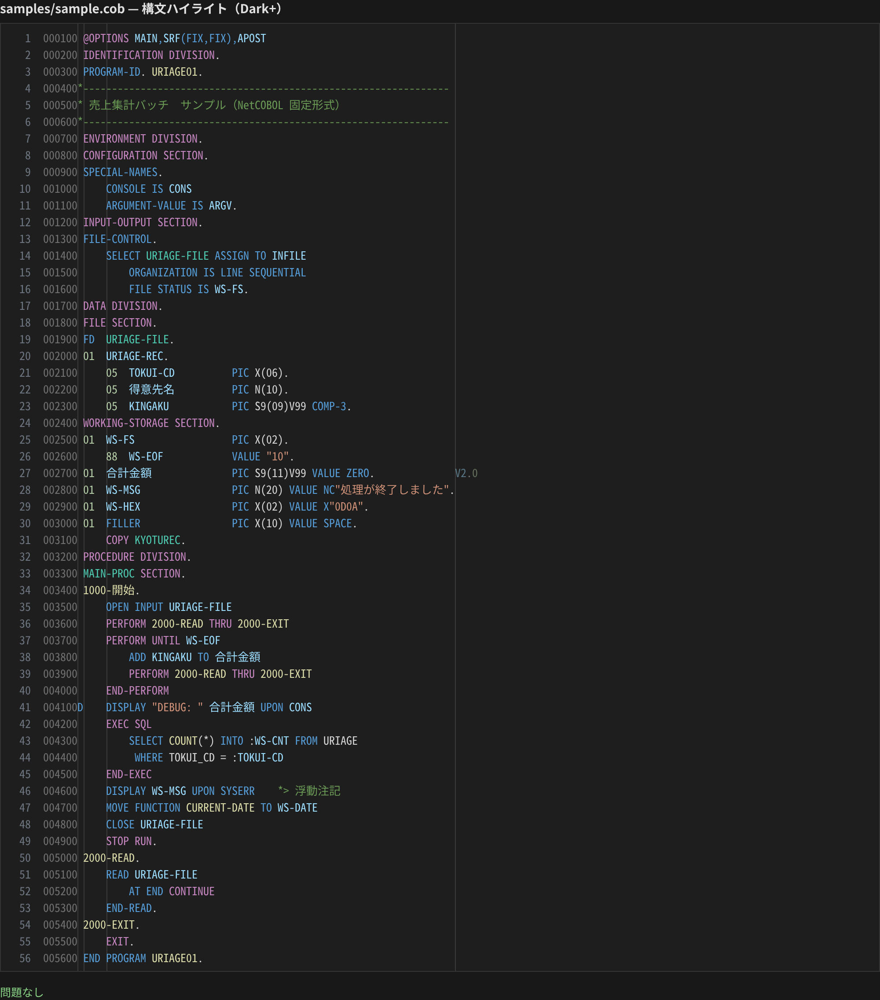
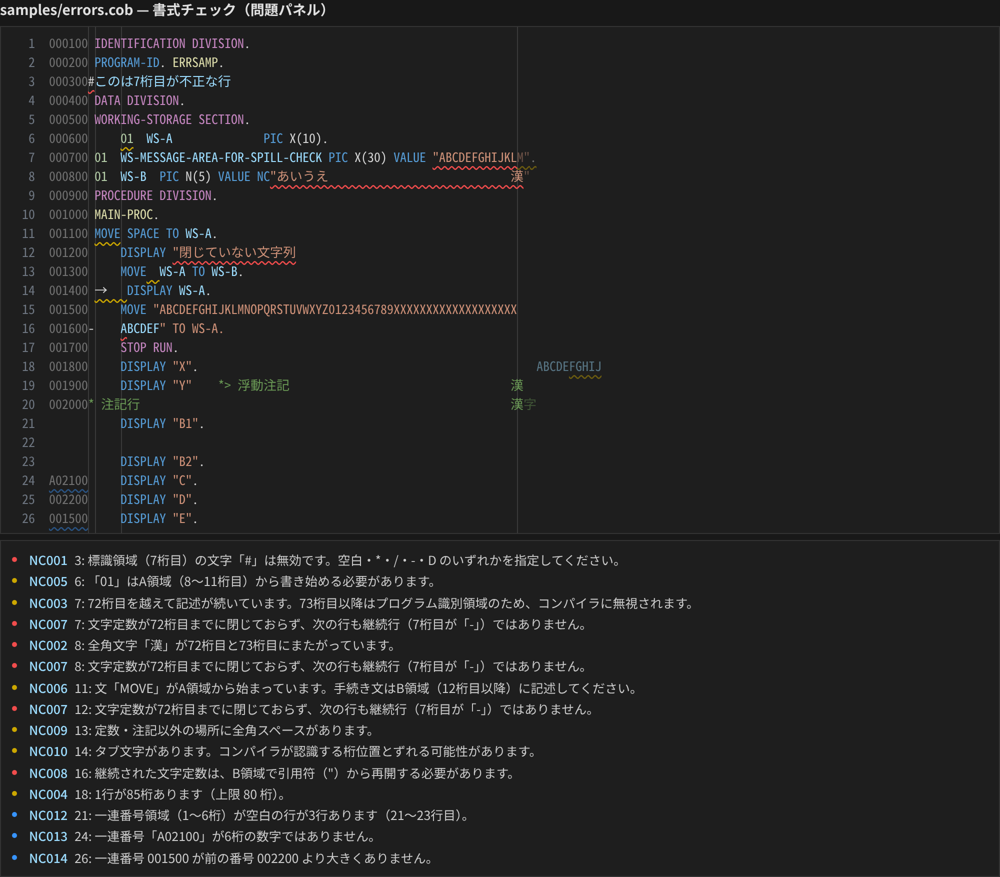

# COBOL Tools for NetCOBOL

[日本語](../README.md) | English | [简体中文](README.zh-CN.md)

A VS Code extension for **NetCOBOL fixed-format source**.
Columns are counted in **Shift_JIS bytes (full-width = 2 columns)**, so lines containing Japanese are checked at the same columns the compiler uses.

> This is an **unofficial** extension and is not affiliated with Fujitsu Limited. NetCOBOL is a registered trademark of Fujitsu Limited.



## Features

### Syntax highlighting
- Sequence area (columns 1-6) and identification area (73-80) are dimmed, byte-accurately
- Indicator area (column 7): `*` `/` comment lines, `D` debug lines, `-` continuation lines
- Divisions, sections, paragraphs (Japanese names supported), `PERFORM` / `GO TO` targets
- Level numbers, data names (Japanese supported), `PIC` strings, usages such as `COMP-3`
- NetCOBOL literals: `NC"…"` `N"…"` `NX"…"` `X"…"` `B"…"`
- `@OPTIONS`, `*>` floating comments, `EXEC SQL … END-EXEC` (host variables `:WS-X`)
- Function-names such as `SYSERR` / `CONSOLE` / `ARGUMENT-VALUE` / `ENVIRONMENT-VALUE`, special registers, `FUNCTION xxx`

### Format checks (Problems panel)



| Code | Severity | Check |
|---|---|---|
| NC001 | Error | Invalid character in the indicator area (column 7); only space `*` `/` `-` `D` |
| NC002 | Error | Full-width character straddles columns 6/7, 7/8 or 72/73 (72/73 ignored inside comments) |
| NC003 | Warning | Text continues past column 72 (ignored inside comments) |
| NC004 | Warning | Line longer than 80 columns (configurable) |
| NC005 | Warning | Division/section/paragraph header, FD, 01/77 not in area A (columns 8-11) |
| NC006 | Warning | Procedure statement (MOVE, IF, …) starts in area A |
| NC007 | Error | Literal not closed by column 72 and next line is not a continuation line |
| NC008 | Error | Continuation line does not resume the literal with a quote |
| NC009 | Warning | Full-width space outside literals and comments |
| NC010 | Warning | Tab character (columns may not match the compiler) |
| NC011 | Warning | Area A of a continuation line is not blank |
| NC012 | Info | Sequence area is blank (consecutive lines reported once) |
| NC013 | Info | Sequence area is not a 6-digit number |
| NC014 | Info | Sequence number is not greater than the previous one |

Messages follow the VS Code display language (Japanese / English / Simplified Chinese).

### Renumber sequence area
- Editor context menu, or Command Palette: "NetCOBOL: Renumber Sequence Area (columns 1-6)"
- No selection: the whole file from `000010` in steps of 10 (empty lines are numbered too; the empty line after the final newline is left alone)
- With a selection: only the selected lines, continuing from the nearest valid number above
- Also available as a quick fix (`Ctrl+.`) on NC012-NC014
- Start and step: `netcobol.sequence.start` / `netcobol.sequence.step`. One `Ctrl+Z` undoes it

### Other
- `Ctrl+/` (`Cmd+/` on Mac) toggles a `*` comment in column 7
- Defaults for NetCOBOL files: `files.encoding = shiftjis`, rulers at `6, 7, 11, 72`, trailing whitespace trimming off

## Installation

Search for **"COBOL Tools for NetCOBOL"** in the Extensions view.
For VSCodium, Cursor and others use [Open VSX](https://open-vsx.org/extension/zhuuchaofan/cobol-tools-for-netcobol); for offline machines download the `.vsix` from [Releases](https://github.com/zhuuchaofan/cobol-tools-for-netcobol/releases) and use "Install from VSIX…".

### For teams
Add `.vscode/extensions.json` to your project so VS Code recommends the extension to everyone who opens it:

```json
{
  "recommendations": ["zhuuchaofan.cobol-tools-for-netcobol"]
}
```

### Using it alongside other COBOL extensions
Another extension may claim the same file extensions. Switch the language mode (bottom right) to **NetCOBOL**, or set:

```json
"files.associations": { "*.cob": "netcobol", "*.cbl": "netcobol", "*.cpy": "netcobol" }
```

File extensions: `.cob` `.cbl` `.cobol` `.cpy` `.pco`

## Settings

| Setting | Default | Description |
|---|---|---|
| `netcobol.columnCounting` | `shiftjis` | Column counting: `shiftjis` / `utf8` / `character` |
| `netcobol.diagnostics.enabled` | `true` | Enable format checks |
| `netcobol.diagnostics.maxLineLength` | `80` | Maximum line length (0 = off) |
| `netcobol.diagnostics.disabledRules` | `[]` | Rules to turn off, e.g. `["NC010", "NC012"]` |
| `netcobol.dimFixedAreas` | `true` | Dim sequence and identification areas |
| `netcobol.sequence.start` | `10` | First sequence number |
| `netcobol.sequence.step` | `10` | Sequence number increment |

For UTF-8 sources set `files.encoding` to `utf8` and `netcobol.columnCounting` to `utf8`.

## Limitations
- Fixed format only; variable and free format sources get wrong column checks (diagnostics can be turned off)
- Shift_JIS width is "ASCII and half-width katakana = 1, everything else = 2"
- Paragraph names written in area B are not checked (indistinguishable from multi-line statements)

## Feedback and contributing
Report bugs and ideas in [Issues](https://github.com/zhuuchaofan/cobol-tools-for-netcobol/issues) (Japanese, English or Chinese).
**Never paste customer source code or design documents.** Write a minimal sample instead. See [CONTRIBUTING.md](../CONTRIBUTING.md).

## License
[MIT](../LICENSE)
