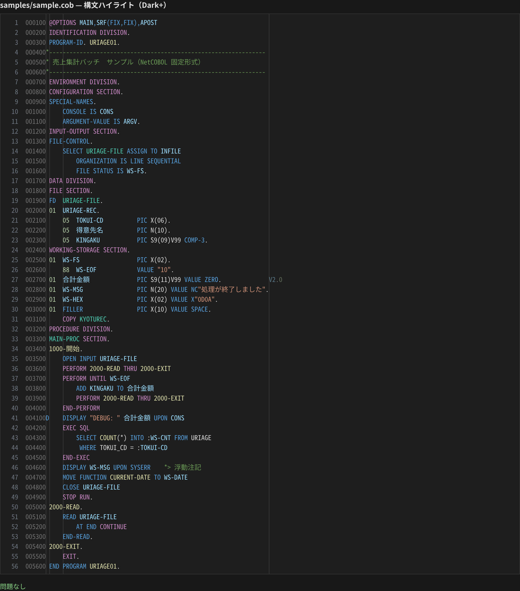
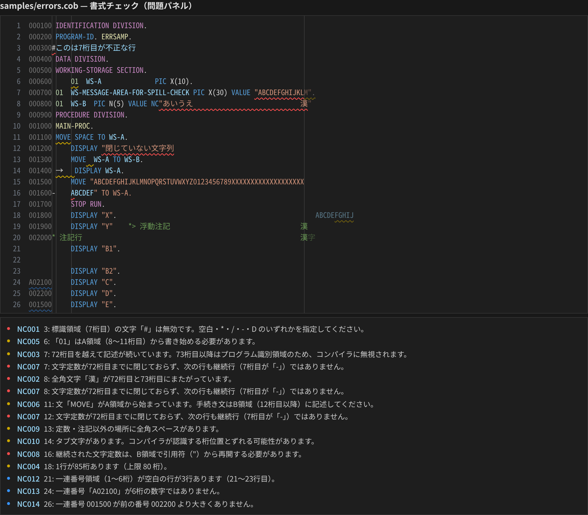

# COBOL Tools for NetCOBOL

[日本語](../README.md) | [English](README.en.md) | 简体中文

面向 **NetCOBOL 固定形式源码**的 VS Code 插件。
列位置按 **Shift_JIS 字节数（全角 = 2 列）** 计算，含日文的行也能和编译器按同样的列检查。

> 本插件为**非官方**插件，与富士通株式会社无关。NetCOBOL 是富士通株式会社的注册商标。



## 主要功能

### 语法高亮
- 序号区（1-6 列）/ 标识区（73-80 列）淡化显示（按字节计算，有全角也不会错位）
- 第 7 列指示区：`*` `/` 注释行、`D` 调试行、`-` 继续行
- DIVISION / SECTION / 段落名（支持日文段落名）、`PERFORM` / `GO TO` 目标
- 层号、数据名（支持日文）、`PIC` 字符串、`COMP-3` 等用法
- NetCOBOL 字面量：`NC"…"` `N"…"` `NX"…"` `X"…"` `B"…"`
- `@OPTIONS`、`*>` 浮动注释、`EXEC SQL … END-EXEC`（主变量 `:WS-X`）
- `SYSERR` / `CONSOLE` / `ARGUMENT-VALUE` / `ENVIRONMENT-VALUE` 等功能名、特殊寄存器、`FUNCTION xxx`

### 格式诊断（问题面板）



| 代码 | 级别 | 内容 |
|---|---|---|
| NC001 | 错误 | 第 7 列（指示区）字符非法（只允许 空格 `*` `/` `-` `D`） |
| NC002 | 错误 | 全角字符跨在 6/7、7/8、72/73 列边界上（72/73 在注释里不检查） |
| NC003 | 警告 | 代码超出第 72 列（注释里不检查） |
| NC004 | 警告 | 行长超过 80 列（可配置） |
| NC005 | 警告 | DIVISION / SECTION / 段落头 / FD / 01 / 77 没有从 A 区（8-11 列）开始 |
| NC006 | 警告 | PROCEDURE DIVISION 中语句（MOVE、IF…）写在了 A 区 |
| NC007 | 错误 | 字符常量到第 72 列仍未闭合，且下一行不是继续行 |
| NC008 | 错误 | 继续行没有以引号重新开始被继续的字符常量 |
| NC009 | 警告 | 常量/注释之外的全角空格 |
| NC010 | 警告 | Tab 字符（列位置可能与编译器不一致） |
| NC011 | 警告 | 继续行的 A 区不是空白 |
| NC012 | 信息 | 序号区为空（连续的行合并成一条） |
| NC013 | 信息 | 序号区不是 6 位数字 |
| NC014 | 信息 | 序号没有比上一行大 |
| NC015 | 错误 | 常量内容不合法（`X"…"` 须成对的16进制、`NX"…"` 须4位一组、`B"…"` 只能 0/1、`N"…"`/`NC"…"` 只能全角） |
| NC016 | 警告 | DIVISION / SECTION 标题后缺少句点 |
| NC017 | 警告 | 无效层号（01-49、66、77、88 以外） |
| NC018 | 错误 | 把保留字用作数据名、段落名或文件名 |

提示信息跟随 VS Code 显示语言（日本語 / English / 简体中文）。

- 第 7 列为 `D` 的调试行：`SOURCE-COMPUTER` 没写 `WITH DEBUGGING MODE` 时按注释行处理，并以斜体淡化显示
- 有 `@OPTIONS SRF(VAR)` 时按可变形式（没有第 72 列右边界）；`SRF(FREE)` 时按自由形式关闭列检查（也可用设置 `netcobol.sourceFormat` 指定）
- 保留字和内置函数列表基于 COBOL 85 标准与 NetCOBOL 常见扩展，之后会再对照 COBOL文法書 核对

### 序号区重新编号
- 编辑器右键菜单，或命令面板「NetCOBOL: 序号区（第1-6列）重新编号」
- 没有选中：整个文件从 `000010` 开始，每行 +10（空行也编号；文件末尾换行后的空行不动）
- 有选中：只处理选中的行，接着上方最近的有效序号继续
- NC012–NC014 的灯泡（`Ctrl+.`）也能一键执行
- 起始值、步长可在 `netcobol.sequence.start` / `netcobol.sequence.step` 修改；`Ctrl+Z` 一步撤销

### 大纲、折叠、跳转定义
- **大纲**（资源管理器的大纲视图、`Ctrl+Shift+O`、面包屑）：程序 → DIVISION → SECTION → 段落；数据部按 FD → 01 → 05 … → 88 层级显示，并附带 `PIC`
- **折叠**：DIVISION、SECTION、段落、组项目、连续注释行、`EXEC SQL` 块
- **跳转定义**（`F12` / `Ctrl+点击`）：段落名、SECTION 名、数据名、文件名；当前文件找不到时，会继续在 `COPY` 进来的 copybook 里找（最多 3 层）。支持 `A OF B` 限定名和 `COPY … REPLACING ==:PRE:== BY ==WS==` 替换
- **COPY 句**：在 copybook 名上 `F12` / `Ctrl+点击` 直接打开该文件
  - 查找位置：当前文件所在文件夹 → `netcobol.copybook.paths` 里的文件夹
  - 扩展名：无扩展名、`.cbl`、`.cob`、`.cpy`、`.cobol` 依次尝试（不区分大小写）
  - `COPY 名称 OF 库名` 还会查找名为该库名的子文件夹

```json
"netcobol.copybook.paths": ["copylib", "${workspaceFolder}/common/copy"]
```

### 其他
- `Ctrl+/`（Mac 为 `Cmd+/`）：在第 7 列切换 `*` 注释
- NetCOBOL 文件默认：`files.encoding = shiftjis`、标尺 `6, 7, 11, 72`、关闭行尾空白自动删除

## 安装

在扩展视图搜索 **「COBOL Tools for NetCOBOL」** 安装。
VSCodium、Cursor 等请从 [Open VSX](https://open-vsx.org/extension/zhuuchaofan/cobol-tools-for-netcobol) 安装；离线环境请下载 [Releases](https://github.com/zhuuchaofan/cobol-tools-for-netcobol/releases) 里的 `.vsix`，用「从 VSIX 安装…」。

### 团队使用
在项目仓库里放一个 `.vscode/extensions.json`，同事打开项目时 VS Code 会提示安装：

```json
{
  "recommendations": ["zhuuchaofan.cobol-tools-for-netcobol"]
}
```

### 与其他 COBOL 插件共存
同一扩展名可能被其他插件接管。把右下角语言模式切换为 **NetCOBOL**，或在 `settings.json` 指定：

```json
"files.associations": { "*.cob": "netcobol", "*.cbl": "netcobol", "*.cpy": "netcobol" }
```

对应扩展名：`.cob` `.cbl` `.cobol` `.cpy` `.pco`

## 设置

| 设置项 | 默认值 | 说明 |
|---|---|---|
| `netcobol.columnCounting` | `shiftjis` | 列计算方式：`shiftjis` / `utf8` / `character` |
| `netcobol.sourceFormat` | `auto` | 书写形式：`auto`（读取 `@OPTIONS SRF`）/ `fixed` / `variable` / `free` |
| `netcobol.diagnostics.enabled` | `true` | 启用诊断 |
| `netcobol.diagnostics.maxLineLength` | `80` | 行长上限（0 为不检查） |
| `netcobol.diagnostics.disabledRules` | `[]` | 关闭指定规则，例如 `["NC010", "NC012"]` |
| `netcobol.dimFixedAreas` | `true` | 淡化序号区与标识区 |
| `netcobol.sequence.start` | `10` | 序号起始值 |
| `netcobol.sequence.step` | `10` | 序号步长 |
| `netcobol.copybook.paths` | `[]` | 查找 copybook 的文件夹 |
| `netcobol.copybook.extensions` | `["", ".cbl", ".cob", ".cpy", ".cobol"]` | copybook 扩展名（按顺序尝试） |

UTF-8 源码：把 `files.encoding` 改为 `utf8`，`netcobol.columnCounting` 设为 `utf8`。

## 限制
- 支持固定形式和可变形式；自由形式只有高亮，不做列检查和大纲
- Shift_JIS 宽度按「ASCII・半角片假名 = 1，其余 = 2」计算
- 不检查写在 B 区的段落名（与跨行语句难以区分）
- 大纲和跳转是按行的简易解析，不处理 `REPLACE` 语句

## 反馈与贡献
问题和需求请提交到 [Issues](https://github.com/zhuuchaofan/cobol-tools-for-netcobol/issues)（日本語・English・中文均可）。
**请不要贴客户源码或设计书**，复现请自己写最小示例。开发方法见 [CONTRIBUTING.md](../CONTRIBUTING.md)。

## 许可证
[MIT](../LICENSE)
